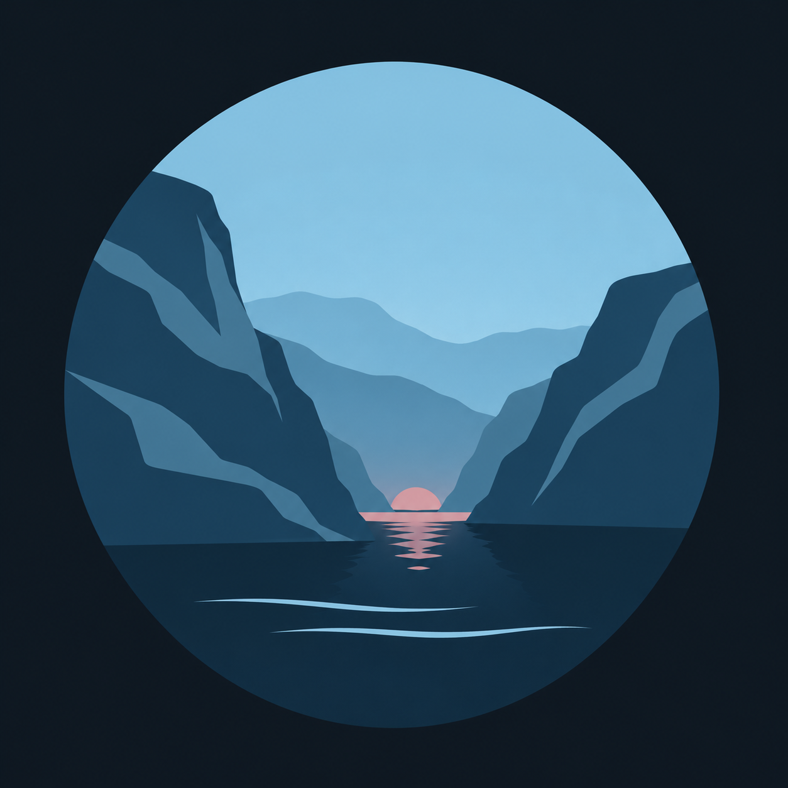

  

<h1 align="center">Fjord Design</h1>

Calm Nordic design, from shared foundations to native experiences.

Fjord brings cool blues, restrained rose accents and readable typography to software.
Its **Night**, **Day** and **Aurora** modes share one design language.

## Projects

| Project | Purpose |
| --- | --- |
| [fjord-design](https://github.com/Fjord-Design/fjord-design) | Shared design tokens, rules, fonts, icons and portable exports. |
| [fjord-kde](https://github.com/Fjord-Design/fjord-kde) | KDE Plasma themes, Konsole profiles, wallpapers and desktop widgets. |

The project repositories are currently private. These links work for members with access.

## One foundation, dedicated implementations

The foundation owns design values and their meaning. Each implementation owns its
platform mappings, packaging and runtime behaviour. This keeps Fjord consistent
while letting each platform feel at home.

## Working together

Read the target repository's README and contribution guidance before making changes.
Keep changes focused, preserve asset licences, and describe how you verified the result.

[Contribution guide](https://github.com/Fjord-Design/.github/blob/main/CONTRIBUTING.md)
· [Security reporting](https://github.com/Fjord-Design/.github/blob/main/SECURITY.md)
